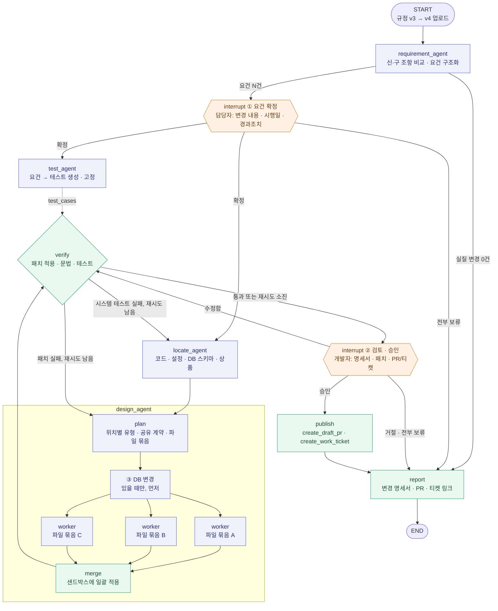

# Rule Ripple · 규정 변경 → 개발 변경 설계 Agent

새 규정이 나오면 개발자가 **무엇을 · 어디서 · 어떻게** 고쳐야 하는지 찾아서, 코드 diff · 설정 변경 · 테스트 · Draft PR · 작업 티켓까지 만들어 주는 Agent입니다.
도메인은 개인신용대출이고, 시연용 가상 데이터를 씁니다.

## 1. 한눈에 보기

| 항목 | 내용 |
|---|---|
| 문제 | 대출 규정이 바뀌면 상품 데이터 · 코드 · 설정 · 문서 · 테스트를 함께 고쳐야 한다. 정보가 여러 시스템에 흩어져 있어서 고칠 곳을 빠뜨리거나, 고치면 안 되는 곳을 고친다. |
| 해결 | 신·구 규정을 비교해 요건을 뽑고, 영향받는 위치를 찾아 변경 명세서와 검증된 패치를 만든다. 사람이 승인하면 Draft PR과 작업 티켓으로 전달한다. |
| 사용자 | 준법감시 · 상품기획 담당자가 요건을 확정하고, 개발팀이 명세서 · PR · 티켓을 받아 작업한다. |
| 가치 | 키워드 검색이 놓치는 위치(단위가 다른 하드코딩, 경과조치처럼 아직 없는 로직)를 찾고, 대상이 아닌 곳은 건드리지 않는다. 판단마다 근거가 남고, 요건에서 만든 테스트가 개발 완료 기준이 된다. |

## 2. 결과물: 변경 1건당 개발 변경 명세서

예시: 고령자 기준 만 65세 → 만 60세 (가상)

| 항목 | 내용 |
|---|---|
| 근거 | 운영기준 v4 제15조 (신·구 원문 링크) |
| 시행일 · 경과조치 | 시행일 이후 신청분부터 적용, 기존 계약은 종전 기준 유지 |
| 위치 | `loan/eligibility.py` `is_senior()` · `config/policy.yaml` · 상품 3개 |
| 유형 | `is_senior()` 하드코딩 → ② 로직, 설정값 추가 → ① 값 |
| 수정안 | `age >= 65` → `age >= policy("SENIOR_AGE", as_of=application_date)`, 설정에 시행일 버전 추가 |
| 테스트 | 59 / 60 / 65세 경계값 × 시행일 전·후 신청, 시스템 테스트(62세 신청자가 신청 API 전체 흐름에서 고령자로 처리되는가) |
| 검증 상태 | 통과 / 검증 실패(재시도 소진). 실패면 publish 기본 차단 |

MVP에서는 경과조치를 DB 마이그레이션 없이 버전이 있는 설정 파일로 처리합니다.

```yaml
# config/policy.yaml
SENIOR_AGE:
  - { value: 65, effective_from: 2020-01-01 }
  - { value: 60, effective_from: 2026-12-01 }   # 신규 버전 추가
```

## 3. 변경 유형 4가지 → 유형별 산출물

유형은 요건이 아니라 **변경 위치(패치 단위)** 마다 붙입니다. 요건 1건이 여러 위치, 여러 유형으로 나뉠 수 있습니다.

| 유형 | 언제 | Agent 산출물 | 예시 (가상) | 범위 |
|---|---|---|---|---|
| ① 값 | 수치만 변경 | 설정 · 상수 diff (시행일 버전 추가) | DSR 0.40 → 0.35 | MVP |
| ② 로직 | 조건 · 계산식 변경 | 함수 수정 diff + 호출부 | 고령자 65 → 60, 하드코딩 제거 | MVP |
| ③ DB | 저장 정보 변경 | migration up/down + 데이터 이관 | `policy_versions(rule_key, value, effective_from)` | 2단계 (MVP는 버전 설정 파일로 대체) |
| ④ 신규 | 새 의무 발생 | 모듈 설계 + 스켈레톤 + 테이블 | 고령자 설명 확인 API + `explanation_records` | MVP는 명세서 · 인터페이스 · 실패하는 테스트까지 |

## 4. 전체 흐름

범례: 초록 = 코드(검증·실행), 파랑 = LLM 판단, 주황 = 사람 개입. 점선 = 데이터 전달.



## 5. 단계별 역할

| 단계 | 담당 | 하는 일 | 저장 |
|---|---|---|---|
| requirement_agent | LLM | 신·구 조항을 비교해 요건을 구조화한다(변경 내용, 대상, 시행일, 경과조치). 실질 변경이 없으면 바로 report로 간다. | `requirements` |
| interrupt ① 요건 확정 | 사람 | 요건 해석을 확정한다. 해석이 틀리면 이후 작업이 전부 버려지므로 가장 먼저 확인한다. | `approvals` |
| test_agent | LLM | 요건에서 경계값 · 시행일 전후 · 시스템 테스트를 만든다. 만든 테스트는 고정되고 design은 수정할 수 없다. | `test_cases` |
| locate_agent | LLM | 코드 · 설정 · DB 스키마 · 상품 규칙에서 영향 위치를 찾는다. 같은 숫자라도 대상이 아닌 곳은 "대상 아님"과 이유를 함께 기록한다. | `change_specs` |
| design_agent | LLM + 코드 | 위치별 패치를 만든다. 내부 구조는 6절. | `code_patches`, `db_migrations` |
| verify | 코드 | 샌드박스에서 패치 적용 · 문법 · 테스트를 실행한다. 패치 실패는 design으로, 시스템 테스트 실패(놓친 위치 의심)는 locate로 되돌린다. 최대 2회. | `code_patches`(검증 결과 · round) |
| interrupt ② 검토 · 승인 | 사람 | 명세서와 패치를 검토하고 PR · 티켓 생성을 승인한다. 사람이 수정했으면 verify를 다시 돌린다. | `approvals` |
| publish | 코드 | 승인된 항목만 Draft PR과 작업 티켓으로 만든다. | `deliveries` |
| report | 코드 | 변경 명세서 · PR · 티켓 링크를 정리한다. | |

## 6. design_agent 내부와 병렬 처리

병렬 단위는 유형(①~④)이 아니라 **파일(모듈) 묶음**입니다.

1. **plan** (LLM 1회): 위치별 유형, 공유 계약(설정 키 · 컬럼명 · 함수 시그니처), 파일 묶음, 의존 순서를 정한다.
2. **③ DB 변경**이 있으면 먼저 순차로 처리한다.
3. **fan-out**: 파일 묶음마다 worker 하나씩 실행한다(LangGraph `Send`). worker는 유형별 프롬프트를 쓴다.
4. **merge** (코드): 샌드박스 하나에 전부 적용한다. 충돌한 묶음만 다시 작업한다.
5. **verify**: 개별 + 통합 테스트. 실패한 묶음만 design으로 돌아가고, round는 묶음별로 센다.

| 위험 | 대응 |
|---|---|
| 같은 파일을 두 worker가 고쳐 충돌 | 같은 파일의 위치는 한 worker에 묶는다 |
| worker마다 다른 이름을 지어냄 (`SENIOR_AGE` vs `senior_age_min`) | 공유 계약을 plan에서 먼저 확정한다 |
| ④ 신규 모듈이 ③ 테이블에 의존 | DB 변경을 먼저 처리한다 |
| 따로는 통과, 합치면 실패 | 개별 검증 뒤 통합 검증을 한 번 더 한다 |
| 병렬 브랜치 안의 interrupt는 재개가 복잡 | interrupt는 fan-out 바깥에 둔다 |

**구현 메모 (LangGraph)**
- test_agent는 locate_agent와 같은 superstep에서 병렬로 한 번만 실행한다.
- verify를 `add_edge(["test_agent", "merge"], "verify")` 같은 join으로 묶으면, 재시도 루프에서 test_agent가 다시 실행되지 않아 verify가 트리거되지 않는다.
- 그래서 verify는 merge 하나에서만 트리거하고, 테스트는 state(`test_cases`)에서 읽는다.

## 7. MCP 서버 · 도구

| 서버 | 도구 | 성격 | 비고 |
|---|---|---|---|
| regulation-mcp | `diff_versions` | 읽기 | 원문 기준 결정적 diff |
| | `search_regulation` | 읽기 | Vector DB 검색 |
| | Resource `reg://{규정}/{버전}/{조항}` | 읽기 | 신·구 원문 링크 |
| code-mcp | `search_code` · `get_file` · `find_usages` | 읽기 | |
| | `check_patch` | 샌드박스 실행 | 원본 레포 변경 없음, 네트워크 · 비밀키 없음 |
| | `create_draft_pr` | 외부 쓰기 · 승인 필요 | Draft까지만, merge는 사람 |
| business-mcp | `get_db_schema` · `get_product_rules` | 읽기 | Spring `/internal/**` 경유 |
| | `create_work_ticket` | 외부 쓰기 · 승인 필요 | Spring `/internal/**` 경유 |

승인이 필요한 도구는 서버가 `approval_id`를 `approvals` 테이블로 검증하고, 멱등키로 중복 생성을 막습니다. 그래프의 interrupt만 믿지 않습니다.

**실행 주체별 도구 권한 (최소 권한)**

| 실행 주체 | 쓸 수 있는 도구 |
|---|---|
| requirement_agent | `diff_versions`, `search_regulation` |
| test_agent | `get_file`, `get_db_schema`, `get_product_rules` |
| locate_agent | `search_code`, `get_file`, `find_usages`, `get_db_schema`, `get_product_rules`, `search_regulation` |
| design_agent | `get_file`, `find_usages`, `get_db_schema` |
| verify (코드 노드) | `check_patch` |
| publish (코드 노드) | `create_draft_pr`, `create_work_ticket` |

## 8. DB

| 구분 | 테이블 | 메모 |
|---|---|---|
| 분석 | `analysis_tasks` · `requirements` · `change_specs` | `requirements`에 시행일 · 경과조치 필드 |
| 산출물 | `code_patches`(diff · 검증 결과 · round) · `db_migrations` · `test_cases` | `test_cases`는 요건 기반, design이 수정 불가 |
| 전달 | `deliveries`(PR · 티켓) · `approvals` | `approval_id`로 쓰기 도구 검증 |
| 운영 | `users` · `task_events` · `checkpointer` | interrupt 후 재개 |
| 샘플 업무 | `products` · `product_rules(rule_key)` · `loan_contracts` | 가상 데이터 |
| Vector DB | 규정 조항(버전 · 시행일) · 코드 문서 · 개발 가이드 | 검색용. diff는 원문 기준 |

## 9. 범위

| 단계 | 포함 |
|---|---|
| MVP | 유형 ①② + 경과조치(버전 설정 파일). 시나리오 2개: DSR 0.40 → 0.35, 고령자 65 → 60. ④는 명세서 · 인터페이스 · 실패하는 테스트까지. 샘플 레포 10~20파일 + 테스트 + 정답지 |
| 2단계 | ③ DB 마이그레이션(`policy_versions`), ④ 스켈레톤 구현 |
| 제외 | 법령 변경 자동 감지, 코드 merge(사람이 함), 보험 · 다른 상품군 |

## 10. 평가와 데모

**정답지**: 샘플 레포에 영향 위치를 미리 심어두고 점수를 냅니다. 바꾸면 안 되는 함정도 함께 심습니다.

| 시나리오 | 바꿔야 하는 곳 (난이도) | 함정 (바꾸면 안 됨) |
|---|---|---|
| 고령자 65 → 60 | `is_senior()`의 `age >= 65` (쉬움), 금리 우대 로직의 `age > 64` (중간: 표현이 다름), `SENIOR_AGE_MONTHS = 780` (어려움: 단위가 다름), 경과조치 분기 (어려움: 없는 로직) | 소득 추정용 `RETIREMENT_AGE = 65` |
| DSR 0.40 → 0.35 | 설정의 `DSR_LIMIT: 0.40` (쉬움), 한도 배치의 하드코딩 `0.4` (중간), 화면 문구 "DSR 40%" (중간) | `LTV_LIMIT = 0.40` (같은 값, 다른 의미) |

**지표**: locate recall · precision, 함정 오판 0건, verify 1회차 · 2회차 통과율, 업로드부터 Draft PR까지 걸린 시간.

**데모 순서 (5분)**
1. 규정 v3 → v4 업로드, 요건 2건 추출, 담당자 확정
2. 영향 위치 목록: 수정 필요 항목과 "대상 아님" 항목(이유 포함)
3. 비교군: 키워드 검색은 `780`, `age > 64`, 경과조치를 놓치고 `RETIREMENT_AGE`, `LTV_LIMIT`를 잘못 고친다
4. 패치 검증: 1회차 실패 → 오류 전달 → 2회차 통과
5. 승인 → Draft PR · 티켓 생성

## 11. 설계 포인트 · 채점 연결

| 설계 포인트 | 내용 | 채점 |
|---|---|---|
| Evaluator-Optimizer 루프 | verify → design / locate, 최대 2회, 실패한 묶음만 재작업. 테스트는 요건에서 따로 만들어 자기채점을 막는다 | Agent 설계·구현 30 |
| 병렬 처리 | test_agent ∥ locate_agent, design 내부 파일 묶음 fan-out | Agent 설계·구현 30 |
| 사람 개입 2번 | ① 요건 확정 ② 검토 · 승인(수정 시 재검증). interrupt · 재개, checkpointer | Harness 20 |
| 검증은 코드 | `check_patch`는 샌드박스에서만 실행, 원본 레포 불변. PR은 Draft까지, merge는 사람 | MCP 20 |
| 쓰기 도구 통제 | `approval_id` 서버 검증 + 멱등키, 쓰기 도구는 LLM 에이전트에 노출하지 않음, 실행 주체별 최소 권한 | MCP 20 |

## 12. 원안 대비 변경점

| 원안 | 변경 | 이유 |
|---|---|---|
| 사람 개입: ① 명세서 확정(verify 뒤) ② publish 승인 | ① 요건 확정(requirement 직후) ② 검토 · 승인 통합 | 요건 해석 오류가 가장 비싸다 |
| 테스트 생성 단계가 없음 | test_agent가 요건에서 먼저 생성 · 고정 | 패치를 만든 쪽이 테스트까지 만들면 자기채점이 된다 |
| verify는 찾은 위치만 검사 | 시스템 테스트 추가, 실패 시 locate로 | 놓친 위치를 잡기 위해 |
| 경과조치는 "주의" 한 줄 | 요건 필수 필드 + `policy(key, as_of)` | 기존 계약에 새 기준이 적용되는 패치를 막기 위해 |
| 유형을 요건 단위로 분류 | 변경 위치 단위로 분류 | 요건 1건이 여러 유형에 걸친다 |
| design 유형별 분기 | plan → 파일 묶음 병렬 → merge | 충돌 · 이름 불일치 방지 |
| 리뷰에서 수정 후 바로 publish | 수정 시 verify 재실행 | 사람이 고친 패치도 검증 |
| 2회 실패한 패치도 리뷰로 | "검증 실패" 표시, publish 기본 차단 | 실패한 패치가 승인되는 것을 막기 위해 |
| `rag-mcp` | `regulation-mcp` | `diff_versions`는 RAG가 아니다 |
| MVP ①②④ | MVP ①② + 경과조치, ④는 명세서까지 | 스켈레톤은 문법 검사밖에 못 해서 검증 루프가 의미 없다 |
